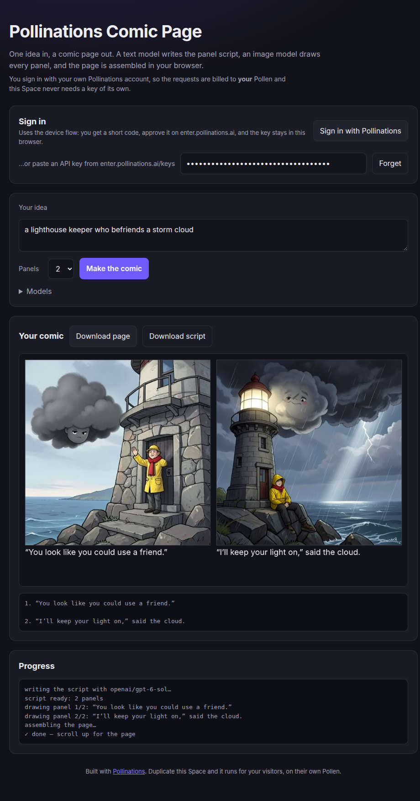

# Pollinations Comic Page

[](https://pollinations.ai/?ref=badge)

One idea in, a comic page out. A text model writes the panel script, an image model
draws every panel, and the page is assembled in your browser.



Built for the Pollinations [quest #17249](https://github.com/pollinations/pollinations/issues/17249).

**Visitors sign in with their own Pollinations account**, so the requests are billed to
their own Pollen and this Space never runs on a key that can dry up.

## Use it

1. Press **Sign in with Pollinations**. A short code appears.
2. Open the link, enter the code, approve. The page receives its own key for your account.
   This is the standard RFC 8628 device flow, so nothing has to be redirected back, which
   is what makes it work from a plain static page.
3. Type an idea, pick 2, 4 or 6 panels, press **Make the comic**.

You can also paste a key from <https://enter.pollinations.ai/keys> instead of signing in.
It is kept in this browser's `localStorage` and never sent anywhere except Pollinations;
**Forget** removes it again.

A page takes roughly 10 seconds per panel.

## Why this Space is static

Gradio and Docker Spaces on `cpu-basic` need a PRO subscription, while static Spaces are
free for everyone. The browser calls Pollinations directly — the API sends
`access-control-allow-origin: *` and allows the `authorization` header on preflight — so
there is no server to pay for, and **duplicating this Space costs nobody anything**.

That is exactly the point of the quest: the app has no key of its own, and every visitor
pays with their own Pollen. The same generator is also in `gradio/` as a Python app for
anyone who wants a server-side backend.

## Make it your own

- **Duplicate this Space** (⋮ → Duplicate this Space). It runs immediately.
- **Get attributed (optional).** Put your Pollinations app key in `APP_KEY` in
  `pipeline.js`. Visitors who sign in are then attached to your app, so you earn your
  share of what they spend. Without it sign-in still works and visitors still pay with
  their own Pollen.
- **Change the comic.** The panel script comes from `SCRIPT_SYSTEM_PROMPT` in
  `pipeline.js`; the page layout is `panelLayout`, which takes a column count; the
  drawing is `composePage` in `app.js`. A speech-bubble layout is a change in one
  function.
- **Change the models.** The two fields under _Models_, or `DEFAULT_TEXT_MODEL` and
  `DEFAULT_IMAGE_MODEL` in `pipeline.js`. Any id from
  <https://gen.pollinations.ai/models> works.

## How it works

The calls live in `pipeline.js`: `BASE_URL` and `ENTER_URL` at lines 8-9, the script request at
line 60, the panel request at line 99, and the device flow at lines 223 and 238 (all under
`https://gen.pollinations.ai` and `https://enter.pollinations.ai`).

| Step     | Call                                                                  |
| -------- | --------------------------------------------------------------------- |
| Sign in  | `POST https://enter.pollinations.ai/api/device/code`, then `POST https://enter.pollinations.ai/api/device/token` until approved |
| Script   | `POST https://gen.pollinations.ai/v1/chat/completions` on a text model                           |
| Panels   | `GET https://gen.pollinations.ai/image/{prompt}?model=…&width=512&height=512`                    |
| Assembly | `<canvas>`, in `composePage`                                          |

Two details worth knowing, because both cost an afternoon otherwise:

- The image endpoint requires **at least 256 px per side**; smaller requests are refused
  with `400`. Panels are 512 px and scaled to fit the page.
- Models do not always answer with clean JSON, so `parsePanels` accepts JSON inside a code
  fence or surrounded by prose, and falls back to line-by-line captions. A rambling model
  still produces a page instead of an error.

## Tests

```bash
node --test 'tests/*.test.mjs'    # 16 tests, no network and no API key
```

They cover the parser fallbacks, the page geometry, the device-flow polling (against a
stub `fetch`), and the app-key attribution.

## Costs

One page is one text request and one image request per panel. On the free tier that is a
fraction of a Pollen; see <https://gen.pollinations.ai/models> for current prices. This
Space has no key, no server, and stores nothing about you beyond the key you sign in with.

## License

MIT.
